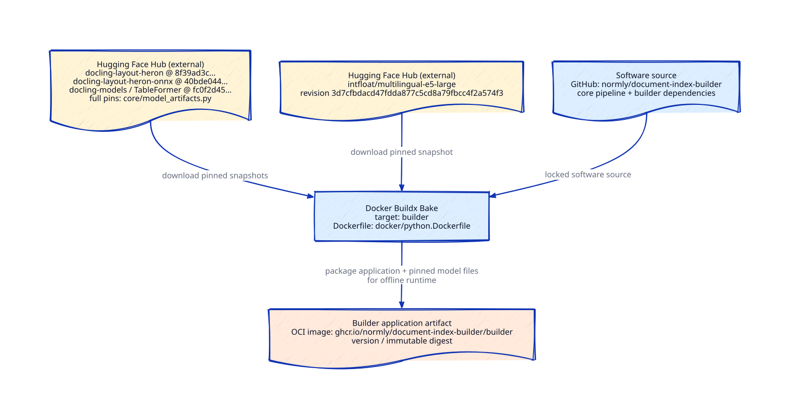
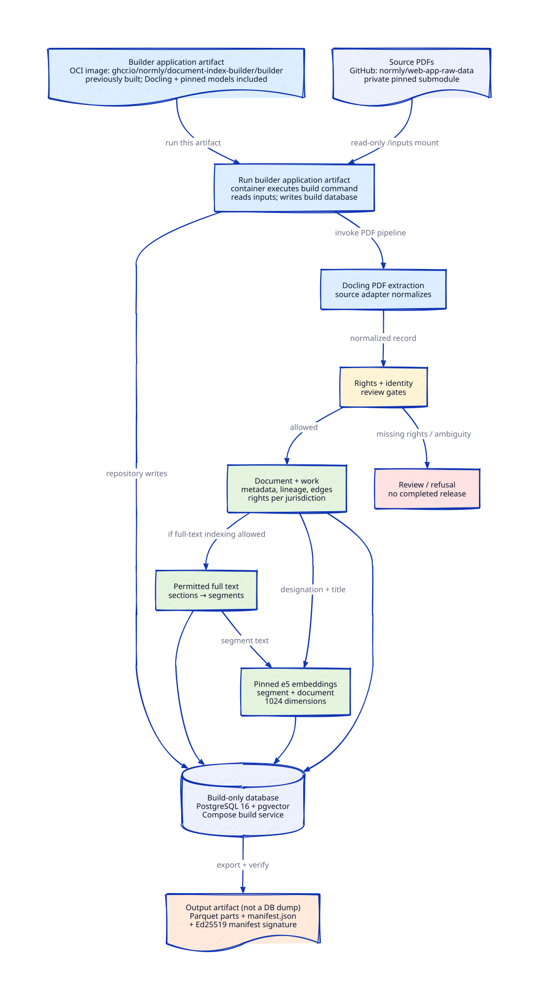
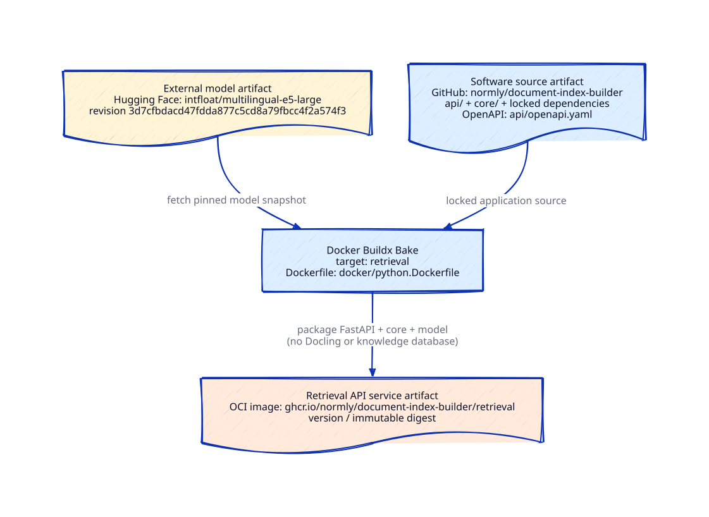
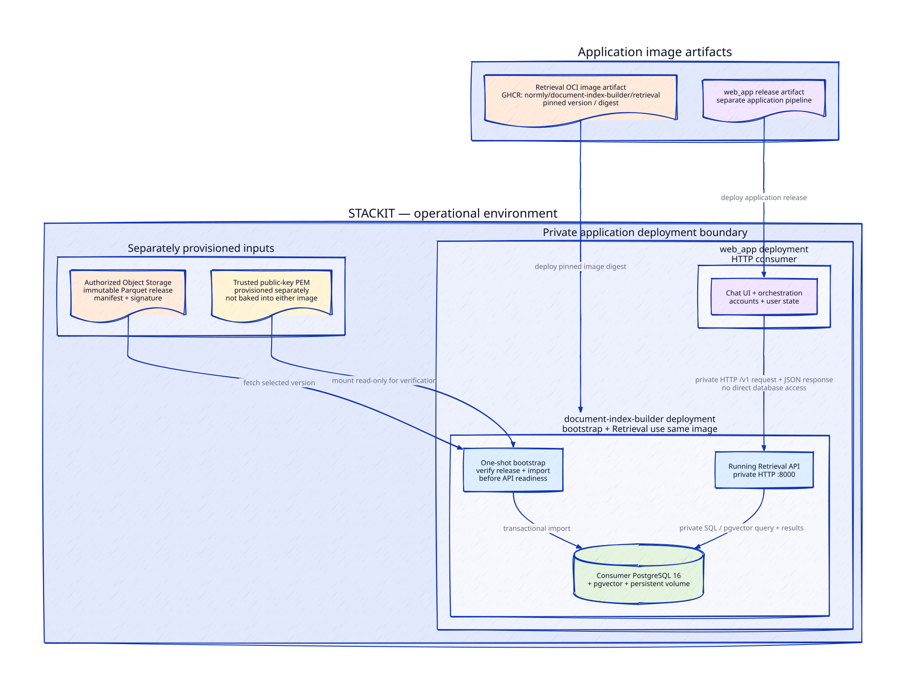
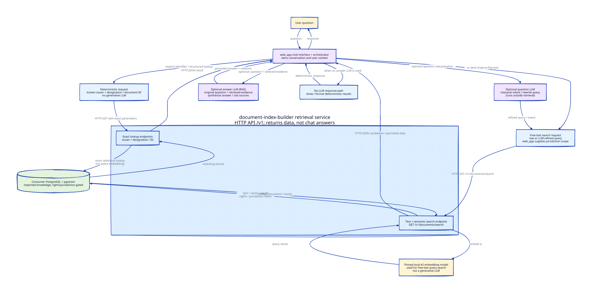

# Document index architecture

The index turns authorized source PDFs into searchable knowledge. It has two
separate stages: a **builder** creates a signed knowledge release, and a
**retrieval service** imports that release into its own database and serves it
over HTTP. `web_app` owns accounts, chat and user state; it accesses retrieval
over HTTP, not through the knowledge database.

## Inputs and boundaries

- The source corpus for this project is the PDFs in the private GitHub repository
  [`normly/web-app-raw-data`](https://github.com/normly/web-app-raw-data),
  checked out here as the `web-app-raw-data` Git submodule. Thus the PDFs come
  from that repository—not from `document-index-builder`. To build from this
  corpus, a contributor or authorized build job needs GitHub access and must
  initialize the pinned submodule. The builder can also accept a different,
  separately authorized directory of inputs. Retrieval has no dependency on or
  access to the raw-data repository.
- The current shared extraction path accepts **PDFs**. The registered adapters
  are `baua`, `dguv`, and `eur-lex`.
- Source registration and applicable rights classification are required;
  possession of a PDF or access to the submodule is not permission to process
  it. Rights also control full-text indexing, citation and free export. Do not
  commit private PDFs, extracted text, releases or keys, or put them in public
  CI. Follow the storage and publication rules in [AGENTS.md](../AGENTS.md).
- Runtime retrieval does not ingest PDFs or include Docling. Its database is
  separate from both the build database and the application database.

## View 1 — build: inputs, processing, outputs

The builder application itself is a prebuilt OCI image. The following view
shows how this software artifact is assembled; it is separate from running the
artifact against PDFs and a build database.





### Source and output provenance

| Item | Origin / produced by | Format and role |
|---|---|---|
| Source PDFs | Private GitHub repository [`normly/web-app-raw-data`](https://github.com/normly/web-app-raw-data), pinned by the `web-app-raw-data` submodule | Original PDF input, mounted read-only to the builder. Not copied into the software image or public CI. |
| Build configuration | Maintained from [`builds/example.json`](../builds/example.json) in this repository | JSON naming input mount paths, adapters, build identity and pinned model. Local working config belongs in ignored `.local/`. |
| Builder software | This `normly/document-index-builder` repository: `core/`, its locked dependencies, and the builder target in [`docker/python.Dockerfile`](../docker/python.Dockerfile) | Container image with Docling extraction, adapters, pipeline, exchange exporter and pinned offline models. It does not contain the private corpus. |
| Build database | Started by [`compose.build.yaml`](../compose.build.yaml) for a dedicated experiment | PostgreSQL 16 with pgvector; relational build rows and `vector(1024)` embeddings. Intermediate/persisted build state, not the portable delivery artifact. |
| Knowledge release | Exported by the builder from approved rows after successful gates | Immutable directory: Parquet table parts, `manifest.json`, and Ed25519 `manifest.json.sig`. `build-provenance.json` is an additional unsigned informational sidecar. This is not a container, SQL dump, or PostgreSQL volume. |

The builder hashes each input, extracts its PDF with Docling, and uses the
source adapter to normalize metadata, text and references. The pipeline records
source and delivery lineage and checks rights and identity before persisting
document content. Missing or denying rights and ambiguous identities go to
review; unresolved reviews, skipped or corrupt PDFs, and other failed release
checks prevent a completed release.

Allowed documents are associated with works and stored with designations,
titles, rights and relations. Where full-text indexing is allowed, sections
become segments. The builder embeds segment text and, separately, the primary
designation and first title when available. The supported model is
`intfloat/multilingual-e5-large`, pinned revision
`3d7cfbdacd47fdda877c5cd8a79fbcc4f2a574f3`, with 1024-dimensional vectors.
See [ingestion data flow](guide/ingestion-data-flow.md) and the
[data model](guide/ingestion-data-model.md) for details.

### Build a release from the private corpus

Use the operator-facing [README build steps](../README.md#build-a-signed-knowledge-release)
for prerequisites, submodule setup, image preparation, configuration and the
exact command. This guide focuses on the pipeline and data boundaries rather
than duplicating the run instructions.

At a high level, the command runs the already-built Builder OCI image with the
authorized input directory mounted read-only, a dedicated PostgreSQL/pgvector
build database, private configuration and an existing Ed25519 signing key. It
exports and verifies a release under the selected output directory; it does not
publish that release. Build identity, review gates, retry behavior and
promotion requirements are covered in [Building knowledge](guide/building-knowledge.md)
and [Signed knowledge releases](guide/knowledge-releases.md). Never reuse the
consumer or shared application database for a build.

## What is the database artifact?

The builder writes **relational PostgreSQL rows and pgvector vectors** into its
own build database: works, documents, designations, titles, source and delivery
lineage, rights, edges, segments, and document/segment embeddings. The vectors
are PostgreSQL `vector(1024)` values. This is not a single JSON document or a
standalone vector database.

The portable output is **not a PostgreSQL dump or a database image**. It is an
immutable knowledge-release directory containing Parquet parts for approved
knowledge tables, `manifest.json`, and an Ed25519 `manifest.json.sig`. The
signature authenticates the manifest; the manifest records checksums and row
counts for the parts as well as exchange/model identity. `build-provenance.json`
is informational and unsigned. Build-only state, user data and nonexportable
content are excluded. The exchange schema version is distinct from the
database migration version.

At deployment, a separately trusted public key is used to verify the release
and a bootstrap process imports it transactionally into a **different**
PostgreSQL/pgvector database. The API queries that consumer database. See
[signed knowledge releases](guide/knowledge-releases.md) for trust, filtering,
withdrawal and update semantics.

## View 2 — artifact production and publication

This view ends at the published software and knowledge artifacts; it does not
show deployment of the running chat/retrieval application. It has two distinct
artifact tracks:

| Artifact | Where it comes from | Type and destination |
|---|---|---|
| Builder and retrieval images | Software source in this `normly/document-index-builder` repository, built from `docker/python.Dockerfile` targets and `docker-bake.hcl`; verified images are published at `ghcr.io/normly/document-index-builder/{builder,retrieval}` | OCI container images. The builder image contains ingestion/Docling; retrieval contains the FastAPI service and pinned query model, but no Docling or source PDFs. Software CI uses synthetic data only. See [software release process](guide/releasing.md). |
| Knowledge release | Produced by the authorized builder from PDFs sourced from the private [`normly/web-app-raw-data`](https://github.com/normly/web-app-raw-data) repository/submodule, then reviewed and promoted separately | Immutable Parquet table parts + `manifest.json` + Ed25519 signature, published to the authorized STACKIT Object Storage route. This is a data artifact, not an image or database dump. |



The real-data builder run is a separate authorized operation from the software
image workflow. It reads authorized PDFs, writes to its dedicated PostgreSQL 16
+ pgvector build database, exports a signed release, and does not publish that
release automatically. Private signing keys and actual corpus data must not be
put in GitHub CI or container images. Production knowledge and publication
belong on STACKIT. The build database is not the runtime database.

In particular, the **retrieval OCI image is not part of the knowledge package
and is not built by the database build**. It is a separate software artifact
created from this repository's retrieval target. The data build uses the
builder image and produces Parquet plus a signed manifest. Later, the runtime
deploys the retrieval service and imports that data package into its own
consumer database.

Container build definitions and release origins are in [`docker-bake.hcl`](../docker-bake.hcl), [`docker/python.Dockerfile`](../docker/python.Dockerfile), and [independent software releases](guide/releasing.md). The build command and data-release gates are in [Building knowledge](guide/building-knowledge.md).

## View 3 — application deployment: hosted runtime components

**Watchout: only here temporarily. is out of scope of this repo.**



This is the **functional, deployed application stack**, separate from building
and publishing artifacts above. Operational services, actual knowledge and
persistent storage belong on **STACKIT** under the repository's operating
policy. The diagram describes the intended component boundary and required
inputs, not a claim that a deployment has already been performed. Local Compose
startup and update steps are in [Self-hosting](guide/self-hosting.md).

The two application deployments are separate: **`web_app` chat consumes the
retrieval service over private HTTP; the retrieval service accesses the consumer
PostgreSQL database. `web_app` does not connect to that database directly.**

| Runtime component / input | Origin | Hosted role / type |
|---|---|---|
| Retrieval service | Running service uses the retrieval software image produced separately in View 2; built from this repository's retrieval target | Private HTTP service, port 8000; FastAPI + repositories + pinned local query embedding model. The API contract and code are `api/openapi.yaml` and `api/src/normly_api/`. The image is not a knowledge-package component. |
| Consumer database | Provisioned separately for retrieval on STACKIT; local topology is in [`compose.yaml`](../compose.yaml) | Private PostgreSQL 16 + pgvector with persistent volume. Contains the imported consumer knowledge; never reuse the builder database volume. |
| Knowledge-release input | Selected immutable version from authorized STACKIT Object Storage | Parquet + manifest + signature. Bootstrap verifies and imports it transactionally into the consumer database. |
| Trust key | Provisioned independently to the retrieval/bootstrap deployment | Public-key PEM verifies the release. Do not trust a key downloaded only alongside an untrusted release. Private signing key is never in the runtime deployment. |
| Chat application | `web_app` project and its separate application build/deployment pipeline | Own hosted application service and user-state storage; owns chat orchestration, accounts and user state. It does not come from this repository and gets no knowledge DB credentials. |

The retrieval API is built and released by this repository—not by `web_app` or
the raw-data repository. Deployment details for the chat service and its
generation model belong to the `web_app` project.

## View 4 — runtime: chat request to knowledge and response

**Watchout: only here temporarily. is out of scope of this repo.**



### HTTP retrieval interface

The retrieval image exposes a versioned HTTP API. With the supplied Compose
setup, a trusted frontend/BFF on the private Docker network reaches it at
`http://retrieval:8000`; neither PostgreSQL nor retrieval has a host-published
port by default. Use a trusted ingress for HTTPS and do not expose the service
directly to untrusted clients while trusting forwarded headers. The application
does not need database credentials.

The retrieval API is an HTTP search/read service, **not** the chat UI, chat
orchestrator, or a standalone generative chat model. It uses its bundled
embedding model to search; `web_app` remains responsible for the conversation
and deciding how to use the returned documents/passages.

For an AI-assisted chat turn, `web_app` sends the user's retrieval query (and
the required jurisdiction scope) to retrieval over HTTP. Retrieval embeds the
query, applies text/semantic matching and rights/jurisdiction filters against
the consumer PostgreSQL/pgvector database, and returns matching document/work
metadata and permitted result data as JSON. `web_app` receives that response
and continues its chat flow. This is a request/response boundary; retrieval
does not call back into chat or read account/chat tables.

The runtime-flow diagram shows three choices that can be combined:

1. **Deterministic lookup, no generative LLM:** when the user or application has
   an issuer/designation or document ID, `web_app` calls the corresponding
   retrieval endpoint and presents the returned record. Exact lookup does not
   need a generated search query or query embedding.
2. **Free-text retrieval, no generative LLM:** `web_app` sends the original
   question to `/v1/documents/search`. Retrieval uses its pinned e5 embedding
   model along with text matching; this is vector-based retrieval, not
   generative LLM inference. The application can display or deterministically
   format the returned results.
3. **LLM-assisted retrieval/answering:** optionally use an LLM in `web_app` to
   interpret or rewrite the question before calling retrieval. After results
   return, optionally pass the original question and selected retrieved data to
   the chat/answer LLM to synthesize a grounded response. Either LLM step is
   optional; neither runs inside the retrieval API. `web_app` supplies the
   jurisdiction scope from its application context rather than delegating that
   access-control decision to the question LLM.

| Method and path | Purpose |
|---|---|
| `GET /health/ready` | Readiness after compatible knowledge is imported. |
| `GET /v1/documents/search` | Work-oriented text and semantic search; requires `jurisdiction`, with optional `q`, `issuer`, `limit` and `offset`. |
| `GET /v1/documents` | Look up a document by `issuer`, `designation` and `jurisdiction`. |
| `GET /v1/documents/{document_id}` | Document details, scoped by jurisdiction. |
| `GET /v1/documents/{document_id}/edges`, `/work`, `/validity`, `/rights`, `/segments` | Relations, work structure, validity, rights and permitted segments. |
| `GET /v1/export` | Rights-gated free graph export, **not** the signed-release download. |
| `GET /openapi.json`, `/docs`, `/redoc` | Running service schema and interactive/reference documentation. |

For example, from a client on the private network, substitute a jurisdiction
and query appropriate to the imported release:

```sh
curl --get 'http://retrieval:8000/v1/documents/search' \
  --data-urlencode 'jurisdiction=DE' --data-urlencode 'q=Arbeitsschutz'
```

Search ranks text matches ahead of semantic candidates and groups editions by
work. A missing or jurisdiction-invisible document returns 404; rights can
restrict segments even for a visible document. Retrieval uses the same pinned
model for query embeddings.

**Where the HTTP API is documented:** the version-controlled contract is
[`api/openapi.yaml`](../api/openapi.yaml) in this repository. Its FastAPI
implementation is in [`api/src/normly_api/`](../api/src/normly_api/), with
search in `routers/search.py` and document/read endpoints in the other router
modules. Contract semantics and security notes are in the
[retrieval API guide](guide/retrieval-api.md); the running image also serves
`/openapi.json`, `/docs` and `/redoc`. The API contract and server container
come from the retrieval target built from **this** repository, not from
`web_app` or the raw-data repository. See [self-hosting](guide/self-hosting.md)
for startup, import and updates.

## Render and reuse the diagrams

The editable sources are [D2](https://d2lang.com/) files in
[`docs/diagrams/`](diagrams/); the checked-in SVGs above are ready for READMEs
and presentations. With D2 CLI v0.9.0 installed, regenerate the hand-drawn
sketches from the repository root:

```sh
d2 --sketch docs/diagrams/index-build.d2 docs/diagrams/index-build.svg
d2 --sketch docs/diagrams/index-builder-build.d2 docs/diagrams/index-builder-build.svg
d2 --sketch docs/diagrams/retrieval-build.d2 docs/diagrams/retrieval-build.svg
d2 --sketch docs/diagrams/runtime-deployment.d2 docs/diagrams/runtime-deployment.svg
d2 --sketch docs/diagrams/runtime-flow.d2 docs/diagrams/runtime-flow.svg
```

For slide software that prefers raster images, render a separate PNG with the
same command and a `.png` output path; D2's PNG export requires a compatible
headless browser. Review diagrams after architecture changes and regenerate
their SVGs together with the source.
