# Ingestion data flow: PDF through Docling to PostgreSQL

This guide describes the current builder path from an authorized source PDF to
the knowledge rows written in PostgreSQL. It focuses on transformations and
Python objects; the related table structure is shown in
[`ingestion-data-model.md`](ingestion-data-model.md).

> **Input scope:** the shared converter currently accepts PDF only. It uses
> Docling's PDF pipeline; ODF/ODT input is not supported by this path.

## Transformation flow

```mermaid
flowchart LR
    input["Registered source adapter\nAuthorized PDF path"] --> hash["Read bytes\nCompute SHA-256"]
    hash --> extract["extract_document(path)\nDocling DocumentConverter\nInputFormat.PDF"]
    extract --> dd["DoclingDocument\nDocling's structured document"]
    dd --> items["iterate_items()\nordered (item, level) pairs"]
    items --> adapter["Source adapter\nextract metadata and text\nnormalize adapter-specific structure"]
    hash --> record["RawRecord\nsource ID, hash, designation, issuer,\ntitle, full text, language, references"]
    adapter --> record
    record --> delivery["Runner\nDeduplicate by source + hash\nrecord Delivery in savepoint"]
    delivery --> rights{"Rights classification\nexists and may_process?"}
    rights -->|"No / ambiguous identity"| review["Identity review case\nno document text artifacts"]
    rights -->|"Allowed"| identity["Resolve identity and Work\nreuse or create Document"]
    identity --> metadata["Persist metadata and relations\nDesignation, title, rights, edges"]
    metadata --> docvec["DocumentEmbedding\nembed primary designation\n+ first title, if available"]
    record --> fulltext{"full_text present\nand may_index_fulltext?"}
    rights --> fulltext
    fulltext -->|"Yes"| sections["adapter.extract_structure(record)\nlist[RawSection]"]
    sections --> segments["Persist Segment rows\nsequence, heading, text, language"]
    segments --> segvec["Embedding rows\nembed each Segment.text\npgvector(1024)"]
    dd -. "optional, rights-gated Markdown sidecar" .-> markdown["Local Markdown output\nnot a database row"]
    dd -. "inspection only" .-> json["Native Docling JSON\nnot an ingestion database row"]
```



The source is registered and rights classification is checked before document
content artifacts are written. The runner records a `Delivery` inside the
per-record savepoint before processing the record; an existing delivery for the
same source and content hash is skipped. A missing or denying rights rule, or
an ambiguous identity, routes the record to review instead of persisting its
document text.

## Python objects and nesting

`extract_document(path)` returns a Docling `DoclingDocument`. Adapters walk
`document.iterate_items()`, which yields ordered `(item, level)` pairs. They
read item text and adapter-specific labels to derive metadata and text. The
current shared `RawRecord` intentionally contains normalized record fields,
not the original nested Docling item tree or item labels.

```text
DoclingDocument
└── ordered Docling items: (item, level)[]
    └── source adapter extracts and normalizes
        └── RawRecord (frozen dataclass)
            ├── source_id, content_hash
            ├── raw_designation, raw_issuer, raw_title, edition
            ├── full_text, language
            ├── raw_references: list[RawReference]
            │   └── target_issuer, target_designation, edge_type
            └── fetched_at
```

`RawRecord.full_text` is a text field, not a nested list of Docling items.
Each source adapter separately turns it into `list[RawSection]` when full-text
indexing is permitted:

```text
RawSection
├── sequence_number: int
├── heading: str | None
└── text: str
```

The runner resolves a `RawRecord` to a `Document` and associated relational
rows. Each `RawSection` becomes a `Segment`; each segment's text is embedded
and stored in a related `Embedding` row. Separately, the document's primary
designation and first title (when present) form the text for a
`DocumentEmbedding`. Vectors use the configured embedding model and are stored
as 1024-dimensional pgvector values.

The database stores the project's domain records, not a serialized
`DoclingDocument`. The native Docling JSON and Markdown are inspection/diagnostic
outputs; Markdown sidecars are optional and require the applicable free-export
right. Inspection writes files without running the database, chunking, or
embedding stages.

## Code map

- `core/src/normly_core/pipeline/docling_extraction.py` — PDF conversion to
  `DoclingDocument`.
- `core/src/normly_core/pipeline/adapters/` — source-specific metadata, text,
  and section extraction.
- `core/src/normly_core/pipeline/domain.py` — `RawRecord`, `RawReference`, and
  `RawSection` types.
- `core/src/normly_core/pipeline/runner.py` — rights/identity gates and
  repository writes.
- `core/src/normly_core/graph/postgres/orm.py` — PostgreSQL table mappings.
- `core/src/normly_core/pipeline/document_embedding.py` — document search text
  and embedding construction.
