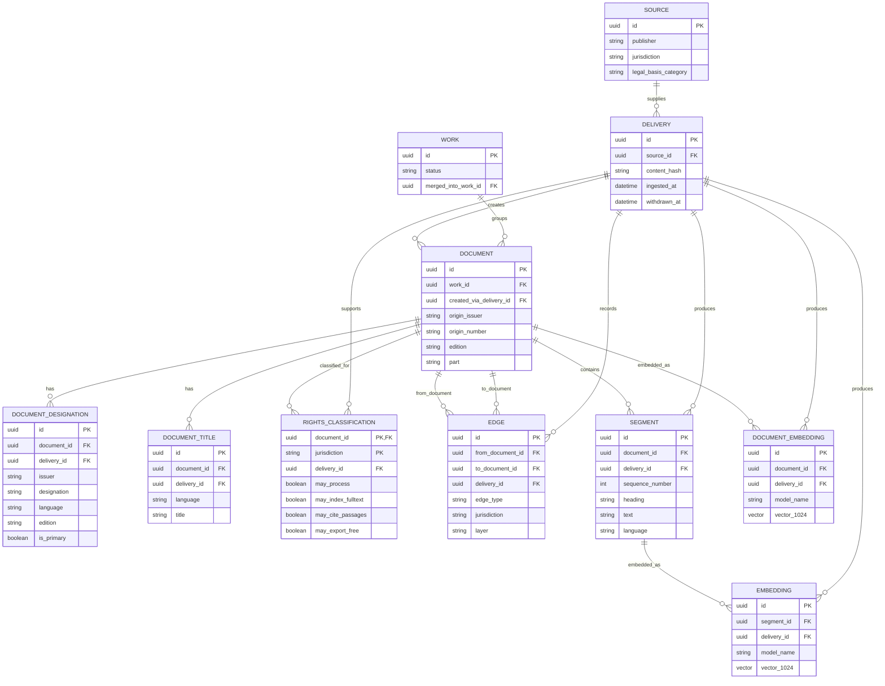

# Ingestion data model in PostgreSQL

This guide shows how the ingestion pipeline's objects are persisted as
PostgreSQL rows. The database is relational: the apparent parent/child shape
is represented by foreign keys, not by storing one nested document object or
JSON tree. See [`ingestion-data-flow.md`](ingestion-data-flow.md) for the
transformations that produce these rows.

## Knowledge rows and relationships



The diagram focuses on rows directly involved in source delivery, document
metadata, full-text indexing, and search vectors. It omits build/import state
and identity-review tables. A delivery is the provenance link for ingested
content: its source and content hash identify the input, and child rows record
which delivery produced or classified them.

## What is nested—and what is not

In Python, a `RawRecord` contains a list of `RawReference` values; its text is
split into a separate list of `RawSection` values by the adapter. In
PostgreSQL, each resulting concept is persisted in its own table:

```text
Source ──< Delivery ──< Document >── Work
                           ├──< DocumentDesignation
                           ├──< DocumentTitle
                           ├──< RightsClassification (per jurisdiction)
                           ├──< Edge (from/to document links)
                           ├──< DocumentEmbedding
                           └──< Segment ──< Embedding
```

These are foreign-key relationships, not nested JSON columns. In particular:

- A `Document` belongs to a `Work`; a `Work` can group multiple editions or
  related documents.
- A `Document` can have designations, titles, rights classifications, edges,
  segments, and a document-level search embedding in separate rows.
- Each `Segment` belongs to one document and one delivery. Its extracted
  heading/text are stored on the `segment` row.
- Each segment embedding belongs to a segment and records its delivery and
  model. The vector column is PostgreSQL `vector(1024)`.
- A `DocumentEmbedding` is separate from segment embeddings. Its source text is
  built from the primary designation and, when available, the first title.
- Rights are keyed by `(document_id, jurisdiction)`. `may_index_fulltext`
  gates segment creation; the other rights flags govern processing, passage
  citation, and free export.

`DoclingDocument`, Docling items, `RawRecord`, and `RawSection` are pipeline
objects, not PostgreSQL entities. The optional local Markdown sidecar and
inspection `document.json` are also not database rows. PostgreSQL receives the
resolved domain data and embeddings described above.

## Schema source

The SQLAlchemy mappings are in
`core/src/normly_core/graph/postgres/orm.py`; the corresponding domain types and
repository protocols are in `core/src/normly_core/graph/domain.py`. Constraints
and nullability in those mappings remain authoritative if implementation
details change.
